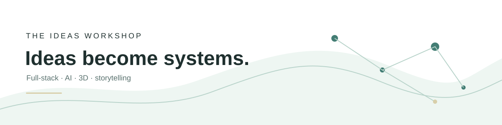

  

[🇮🇹 Italiano](./README.md) · [🇬🇧 English](./README.en.md)

# Ismail Nasry

### Ideas Developer · Full-stack · AI · 3D experiences

I turn ideas into digital products, useful tools and interactive worlds.

[Interactive workshop](https://lab.ismailnasry.it/) · [LinkedIn](https://www.linkedin.com/in/ismailnasry/) · [Get in touch](mailto:info@ismailnasry.it)

> I start with the idea, the people who will use it and the problem it needs to solve. That guides the experience I design and the tools I choose to build it.

## In this profile

[What I do](#what-i-do) · [Skills and tools](#skills-and-tools) · [Projects](#projects) · [Open source](#open-source) · [How I work](#how-i-work) · [What I’m exploring](#what-im-exploring)

## What I do

| Area | What I work on |
| --- | --- |
| Products and web | Full-stack architecture, interfaces, CMS, e-commerce, LMS and SEO. |
| Applied AI | Prompt design, AI-assisted workflows, automation and multi-model orchestration. |
| 3D and interaction | WebGL, Three.js, React Three Fiber, Blender, Unity and interactive 3D experiences. |
| Narrative | Storytelling, brand identity, comics and content design. |

## Skills and tools

In the Lab, these areas are called Build, Imagine, Shape and Tell.

**Build** - React · TypeScript · Laravel · WordPress · PHP · e-commerce · LMS · SEO  
**Imagine** - AI workflows · multi-model orchestration · automation · digital products  
**Shape** - Three.js · WebGL · React Three Fiber · Blender · Unity · immersive experiences  
**Tell** - storytelling · branding · comics · narrative interfaces

## Projects

### [The Ideas Workshop](https://lab.ismailnasry.it/)

My 3D portfolio: a workshop where visitors can explore projects and skills, take a guided tour and try interactive experiments. A lightweight 2D version is also available.

### [Roomify](https://ismailnasry.it/en/project/roomify-ai-interior-design-studio-en/)

AI + 3D interior design: from floor plans and natural language to interactive 3D scenes.

### [SkillUp](https://ismailnasry.it/project/skillup-piattaforma-lms-per-la-formazione-aziendale/)

An LMS for corporate training, with quizzes and gamification to support learning.

### PromptMaster Pro Studio

A workspace for coordinating multiple AI models and organizing the steps of a task.

### [Dance floor · Ready Player One](https://ismailnasry.it/project/pista-da-ballo-ispirata-a-ready-player-one/)

A Blender scene inspired by Ready Player One, with animated tiles, particles and lights synchronized to music.

### [Mate Smart Lock](https://ismailnasry.it/project/mate-smart-lock/)

A Linux application that locks and unlocks the screen based on how close a smartphone is, detected via Bluetooth. Available on Snap Store and GitHub.

## How I work

1. **Understand** - clarify the problem, who will use the product and the constraints.
2. **Design** - define the content, data and user journeys.
3. **Build** - choose the technologies and create an initial version of the core features.
4. **Test** - check functionality, usability, accessibility and performance.
5. **Release** - prepare for launch and document decisions, limitations and next steps.

## Open source

- [Mate-Smart-Lock](https://github.com/s7ntech82/Mate-Smart-Lock) - locks and unlocks a Linux screen based on smartphone proximity. **Technologies:** Python, GTK3, `bluetoothctl`, `loginctl` · **License:** MIT.
- [Tag Display](https://wordpress.org/plugins/tag-display/) - displays WordPress tags in five formats, from buttons and tag clouds to inline links, pills and hashtags, with visibility and ordering controls. **Technologies:** WordPress, PHP, Gutenberg Block API, Shortcode API · **License:** GPLv2 or later.
- [javascript-tools](https://github.com/s7ntech82/javascript-tools) - a public collection of JavaScript tools under the MIT license.

More about my work: [Profile and skills](./knowledge/profile.en.md) · [tools](./knowledge/capabilities.en.md) · [experience](./knowledge/experience.en.md) · [projects](./knowledge/projects.en.md) · [working process](./knowledge/work-method.en.md) · [sources](./knowledge/evidence.en.md) · [frequently asked questions](./knowledge/faq.en.md)

## What I’m exploring

- Ways to explore content and projects through 3D environments.
- Small interactive experiments that show how I approach a problem and develop a solution.
- Applications that combine AI, 3D and content to meet practical needs.

## Have a project in mind?

If you want to build a digital product, automate a process or create a 3D experience, [let’s talk](mailto:info@ismailnasry.it).
