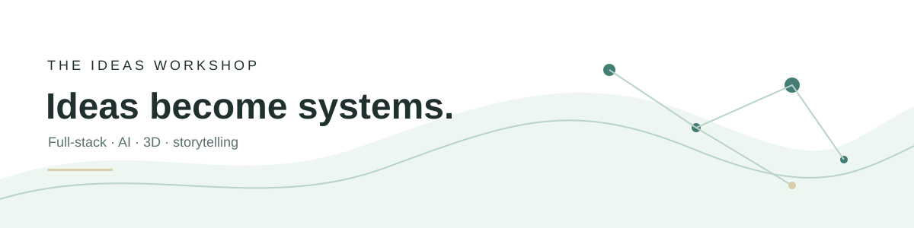

  

[🇮🇹 Italiano](./README.md) · [🇬🇧 English](./README.en.md)

# Ismail Nasry

### Ideas Developer · Full-stack · AI · esperienze 3D

Trasformo idee in prodotti digitali, strumenti utili e mondi interattivi.

[Laboratorio interattivo](https://lab.ismailnasry.it/) · [LinkedIn](https://www.linkedin.com/in/ismailnasry/) · [Contattami](mailto:info@ismailnasry.it)

> Non parto dalla tecnologia. Parto da ciò che deve diventare possibile, poi costruisco il sistema, l’esperienza e il racconto che lo rendono utilizzabile.

## Mappa del laboratorio

[Coordinate](#coordinate) · [Strumenti in pratica](#strumenti-in-pratica) · [Costellazione di lavori](#costellazione-di-lavori) · [Open source](#open-source) · [Come trasformo un’idea](#come-trasformo-unidea) · [Quello che sto testando](#quello-che-sto-testando)

## Coordinate

| Ambito | Cosa porto nel progetto |
| --- | --- |
| Prodotti e web | Architetture full-stack, interfacce, CMS, e-commerce, LMS e SEO. |
| AI applicata | Prompt design, workflow assistiti, automazioni e orchestrazione multi-modello. |
| 3D e interazione | WebGL, Three.js, React Three Fiber, Blender, Unity ed esperienze spaziali. |
| Narrazione | Storytelling, brand, fumetti e sistemi di contenuto con una direzione riconoscibile. |

## Strumenti in pratica

**Build** - React · TypeScript · Laravel · WordPress · PHP · e-commerce · LMS · SEO  
**Imagine** - AI workflow · orchestrazione multi-modello · automazione · prodotti digitali  
**Shape** - Three.js · WebGL · React Three Fiber · Blender · Unity · esperienze immersive  
**Tell** - storytelling · brand · fumetti · interfacce narrative

## Costellazione di lavori

### [The Ideas Workshop](https://ismailnasry.it/)

Portfolio immersivo in cui contenuti, architettura e interazione convivono nello stesso spazio. Il progetto è pensato come un laboratorio esplorabile, con ambienti tematici, percorsi guidati, esperimenti e fallback accessibile.

### [Roomify](https://ismailnasry.it/en/project/roomify-ai-interior-design-studio-en/)

Interior design AI + 3D: dalle planimetrie e dal linguaggio naturale a scene 3D interattive.

### [SkillUp](https://ismailnasry.it/project/skillup-piattaforma-lms-per-la-formazione-aziendale/)

Un progetto che esplora l’incontro tra formazione, piattaforme digitali ed esperienze interattive.

### PromptMaster Pro Studio

Uno studio per coordinare più modelli AI e costruire flussi di lavoro strutturati.

### [Pista da ballo · Ready Player One](https://ismailnasry.it/project/pista-da-ballo-ispirata-a-ready-player-one/)

Esperienza virtuale personale con Blender, piastrelle animate, particelle e luci sincronizzate alla musica.

### [Mate Smart Lock](https://ismailnasry.it/project/mate-smart-lock/)

Applicazione desktop Linux pubblicata su Snap Store e GitHub, basata su una chiave di prossimità Bluetooth.

## Come trasformo un’idea

1. **Capire** - chiarisco problema, persone, contesto e vincoli.
2. **Dare forma** - organizzo contenuti, dati, interazioni e responsabilità.
3. **Costruire** - scelgo lo stack adatto e sviluppo un prototipo verificabile.
4. **Provare** - testo usabilità, accessibilità, performance e coerenza.
5. **Rilasciare** - documento ciò che è stato deciso e ciò che può evolvere.

## Open source

- [Mate-Smart-Lock](https://github.com/s7ntech82/Mate-Smart-Lock) - blocca e sblocca lo schermo Linux in base alla prossimità dello smartphone. **Tecnologie:** Python, GTK3, `bluetoothctl`, `loginctl` · **Licenza:** MIT.
- [Tag Display](https://wordpress.org/plugins/tag-display/) - mostra i tag WordPress in cinque formati, da pulsanti e tag cloud a link inline, pill e hashtag, con controllo sulla visibilità e sull’ordinamento. **Tecnologie:** WordPress, PHP, Gutenberg Block API, Shortcode API · **Licenza:** GPLv2 o successiva.
- [javascript-tools](https://github.com/s7ntech82/javascript-tools) - raccolta pubblica di strumenti JavaScript con licenza MIT.

Per il contesto completo: [coordinate e ruoli](./knowledge/profile.md) · [strumenti](./knowledge/capabilities.md) · [esperienza](./knowledge/experience.md) · [lavori e tracce](./knowledge/projects.md) · [ciclo di lavoro](./knowledge/work-method.md) · [fonti](./knowledge/evidence.md) · [domande frequenti](./knowledge/faq.md)

## Quello che sto testando

- Rendere portfolio e prodotti più spaziali, navigabili e memorabili.
- Usare piccoli esperimenti interattivi per far vivere un metodo, non solo mostrare una schermata.
- Collegare AI, 3D e contenuti in strumenti coerenti, invece che in demo isolate.

## Costruiamo qualcosa con un punto di vista

Se hai un’idea che ha bisogno di struttura, tecnologia e un’esperienza riconoscibile, [parliamone](mailto:info@ismailnasry.it).

*Le idee sono solo l’inizio.*

