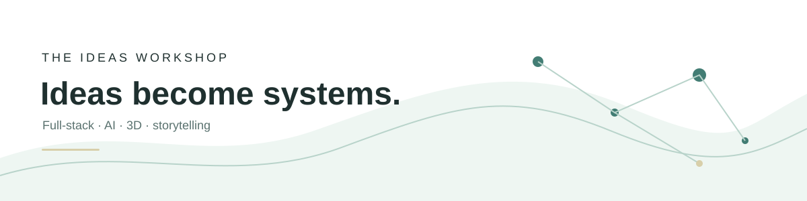

  

[🇮🇹 Italiano](./README.md) · [🇬🇧 English](./README.en.md)

# Ismail Nasry

### Ideas Developer · Full-stack · AI · esperienze 3D

Trasformo idee in prodotti digitali, strumenti utili e mondi interattivi.

[Laboratorio interattivo](https://lab.ismailnasry.it/) · [LinkedIn](https://www.linkedin.com/in/ismailnasry/) · [Contattami](mailto:info@ismailnasry.it)

> Parto dall’idea, dalle persone che la useranno e dal problema da risolvere. Su questa base progetto l’esperienza e scelgo gli strumenti per realizzarla.

## In questo profilo

[Cosa faccio](#cosa-faccio) · [Competenze e strumenti](#competenze-e-strumenti) · [Progetti](#progetti) · [Open source](#open-source) · [Come lavoro](#come-lavoro) · [Cosa sto esplorando](#cosa-sto-esplorando)

## Cosa faccio

| Ambito | Di cosa mi occupo |
| --- | --- |
| Prodotti e web | Architetture full-stack, interfacce, CMS, e-commerce, LMS e SEO. |
| AI applicata | Prompt design, workflow assistiti, automazioni e orchestrazione multi-modello. |
| 3D e interazione | WebGL, Three.js, React Three Fiber, Blender, Unity ed esperienze 3D interattive. |
| Narrazione | Storytelling, identità di marca, fumetti e progettazione dei contenuti. |

## Competenze e strumenti

Nel Lab questi ambiti prendono il nome di Build, Imagine, Shape e Tell.

**Build** - React · TypeScript · Laravel · WordPress · PHP · e-commerce · LMS · SEO  
**Imagine** - AI workflow · orchestrazione multi-modello · automazione · prodotti digitali  
**Shape** - Three.js · WebGL · React Three Fiber · Blender · Unity · esperienze immersive  
**Tell** - storytelling · brand · fumetti · interfacce narrative

## Progetti

### [The Ideas Workshop](https://lab.ismailnasry.it/)

Il mio portfolio 3D: un laboratorio in cui esplorare progetti e competenze, seguire una visita guidata e provare esperimenti interattivi. È disponibile anche una versione leggera 2D.

### [Roomify](https://ismailnasry.it/en/project/roomify-ai-interior-design-studio-en/)

Interior design AI + 3D: dalle planimetrie e dal linguaggio naturale a scene 3D interattive.

### [SkillUp](https://ismailnasry.it/project/skillup-piattaforma-lms-per-la-formazione-aziendale/)

Piattaforma LMS per la formazione aziendale, con quiz e gamification a supporto dell’apprendimento.

### [PromptMaster Pro Studio](https://ismailnasry.it/project/promptmaster-pro-studio-orchestrazione-ai-multi-modello/)

Un ambiente di lavoro per coordinare più modelli AI e organizzare i passaggi di un’attività.

### [Pista da ballo · Ready Player One](https://ismailnasry.it/project/pista-da-ballo-ispirata-a-ready-player-one/)

Una scena realizzata in Blender, ispirata a Ready Player One, con piastrelle animate, particelle e luci sincronizzate alla musica.

### [Mate Smart Lock](https://ismailnasry.it/project/mate-smart-lock/)

Applicazione per Linux che blocca e sblocca lo schermo in base alla vicinanza dello smartphone, rilevata via Bluetooth. Pubblicata su Snap Store e GitHub.

## Come lavoro

1. **Capire** - chiarisco il problema, chi userà il prodotto e quali sono i vincoli.
2. **Progettare** - definisco contenuti, dati e percorsi di utilizzo.
3. **Costruire** - scelgo le tecnologie e realizzo una prima versione delle funzionalità principali.
4. **Verificare** - controllo funzionamento, usabilità, accessibilità e prestazioni.
5. **Rilasciare** - preparo la pubblicazione e documento decisioni, limiti e prossimi passi.

## Open source

- [Mate-Smart-Lock](https://github.com/s7ntech82/Mate-Smart-Lock) - blocca e sblocca lo schermo Linux in base alla prossimità dello smartphone. **Tecnologie:** Python, GTK3, `bluetoothctl`, `loginctl` · **Licenza:** MIT.
- [Tag Display](https://wordpress.org/plugins/tag-display/) - mostra i tag WordPress in cinque formati, da pulsanti e tag cloud a link inline, pill e hashtag, con controllo sulla visibilità e sull’ordinamento. **Tecnologie:** WordPress, PHP, Gutenberg Block API, Shortcode API · **Licenza:** GPLv2 o successiva.
- [javascript-tools](https://github.com/s7ntech82/javascript-tools) - raccolta pubblica di strumenti JavaScript con licenza MIT.

Per approfondire: [Profilo e competenze](./knowledge/profile.md) · [strumenti](./knowledge/capabilities.md) · [esperienza](./knowledge/experience.md) · [progetti](./knowledge/projects.md) · [metodo di lavoro](./knowledge/work-method.md) · [fonti](./knowledge/evidence.md) · [domande frequenti](./knowledge/faq.md)

## Cosa sto esplorando

- Modi per esplorare contenuti e progetti attraverso ambienti 3D.
- Piccoli esperimenti interattivi per mostrare come affronto un problema e arrivo a una soluzione.
- Applicazioni che combinano AI, 3D e contenuti per rispondere a esigenze concrete.

## Hai un progetto in mente?

Se vuoi sviluppare un prodotto digitale, un’automazione o un’esperienza 3D, [parliamone](mailto:info@ismailnasry.it).
